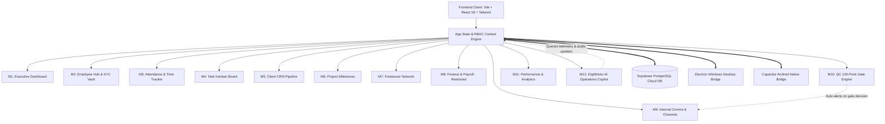

# DigiWorku Commander — System Brain & Cognitive Architecture (BRAIN.md)

## 🧠 Overview
**DigiWorku Commander** operates with an intelligent operational brain that coordinates 12 independent enterprise subsystems, unifies human workflows, automates quality assurance gates, and powers a context-aware AI operations copilot using the Gemini Flash architecture.

---

## 🏗️ Core Architectural Layers

---

## ⚡ Module 12: DigiWorku AI Cognitive Logic

The AI Operations Copilot acts as a mission control officer with direct read access to current state telemetry:

### 1. Context Telemetry Ingestion
- **Delayed Project Radar**: Monitors milestone delivery dates against calendar SLAs. If `daysDelayed > 0` or status is `delayed`, it identifies the active bottleneck (e.g. mobile regression testing, API webhook certification).
- **Sprint Velocity Tracker**: Reads committed vs. completed story points for Sprint 44, calculating team accuracy (90% completion rate).
- **Workforce Capacity Engine**: Analyzes internal developer utilization (currently 88%) and matches available vetted contractors from the Freelancer Network.
- **Client Status Synthesizer**: Auto-generates polite, professional client milestone updates with real staging URLs and QC compliance scores.

### 2. Context-Aware RBAC Guardrail
Before responding to queries regarding finances, payroll, client contract values, or executive settings, the AI cognitive engine evaluates `currentRole`:
- If `currentRole` is `team_member` or `freelancer`, queries asking about revenue, profit margins, or individual salaries are rejected:
  > *"🔒 Access Denied: Under DigiWorku RBAC security protocol, financial metrics and ledgers are restricted to Super Admin and Finance Manager roles."*
- If `currentRole` is `super_admin` or `finance_manager`, the AI delivers complete P&L analytics ($1.42M YTD, $160k monthly, 50.9% margin).

---

## 🔄 Automated Event Dispatchers

| Trigger Event | Source Module | Automated Brain Action |
| :--- | :--- | :--- |
| **QC Gate Decision** | M10 (QC Engine) | Formats and dispatches instant status card to `#qc-alerts` channel |
| **Check-In Past 09:30 AM** | M3 (Attendance) | Flags arrival as `late`, prompts for transit/reason log, and tags in daily report |
| **Leave Request Approval** | M3 (Leaves) | Updates employee leave balance, logs reviewer name, and notifies staff |
| **Milestone Approved** | M6 (Projects) | Promotes stage to client staging, triggers confetti celebration, and unlocks payout |
| **Quote Issued** | M5 (CRM) | Generates quote `#QTE-2026-XXX`, advances lead status to `proposal_sent` |
| **Role Simulator Switch** | Header | Dynamically recalibrates UI, hides restricted tabs, and updates user profile |

---

## 🔒 State Synchronization & Persistence

1. **Active Memory Store**: Managed via React Context API (`src/context/AppContext.tsx`) with zero latency tab switching.
2. **Local Storage Fallback**: Stores runtime Supabase credentials, punch timer progress, and offline cached edits.
3. **Cloud Database (Supabase)**: Real-time PostgreSQL schema with Row Level Security (RLS) policies mapping directly to the 8 roles.
